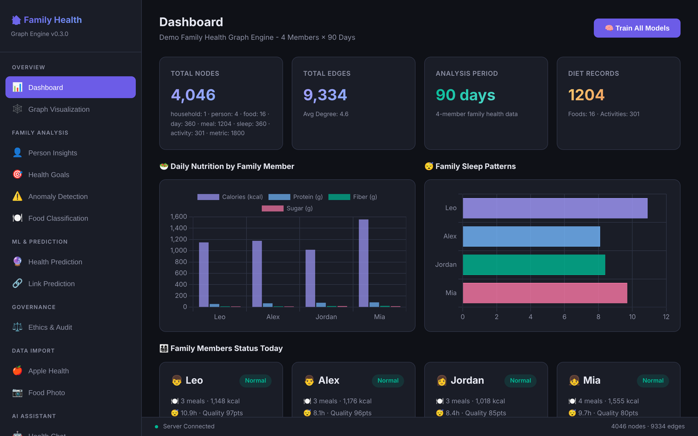
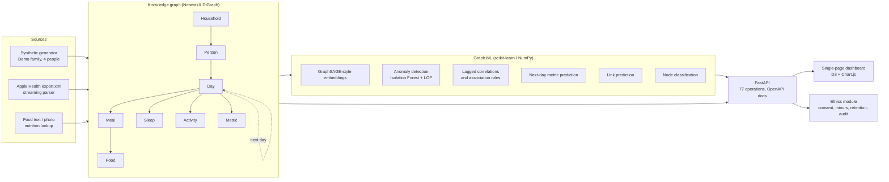
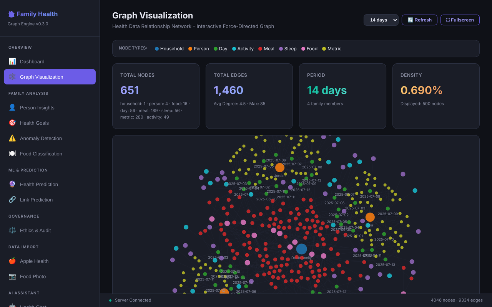
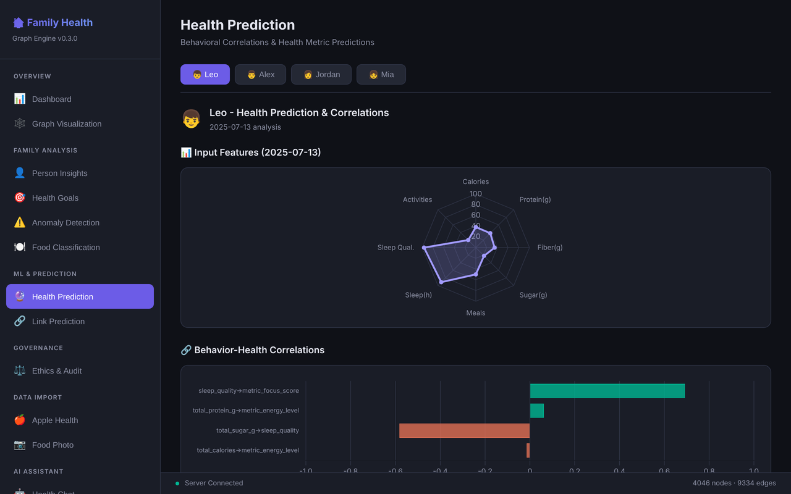
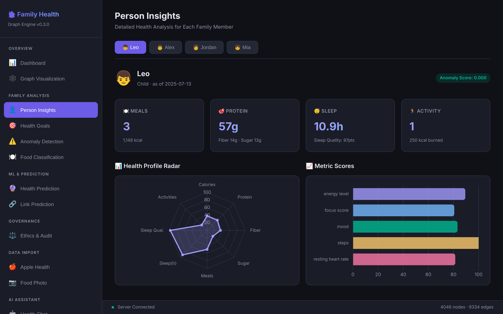
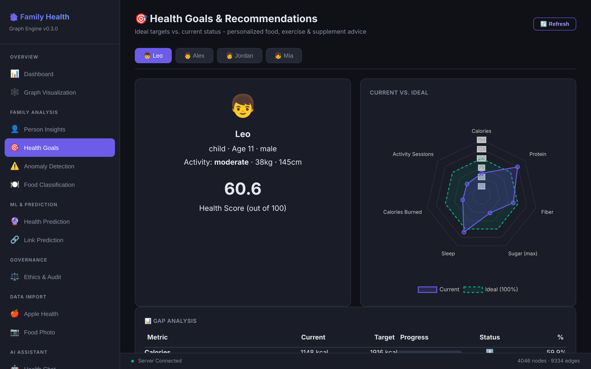

# Family Health Graph Engine

[](https://github.com/deokhwajeong/family-health-graph-engine/actions/workflows/ci.yml)


A FastAPI service that models a household's daily health data (sleep, steps,
heart rate, meals, activities, mood) as a knowledge graph and runs small graph
ML models on it to surface patterns across people and across days.

Author: Deokhwa Jeong, https://www.linkedin.com/in/deokhwa-jeong



## The problem

A family's health data is scattered. Each person has their own phone, watch,
and apps; meals live in one place, sleep in another, a child's sports schedule
in a calendar. Questions that matter at the household level are hard to answer
from separate tables:

- Does a rough night for one child show up in everyone's sleep and energy?
- Does a high-sugar day predict worse sleep the *next* night?
- Which foods tend to appear on a person's best-focus days?

Modelling the data as a graph makes those relationships first-class.
`Household -> Person -> Day -> {Meal -> Food, Sleep, Activity, Metric}` with
`Day -> next Day` links means cross-person and cross-day questions become
graph traversals and features, rather than ad hoc joins.

## Architecture



| Path | What lives there |
|---|---|
| `backend/main.py` | FastAPI app and all routes |
| `backend/app/graph_builder.py` | Graph schema helpers (`add_person`, `add_day`, `add_meal`, ...) |
| `backend/app/synthetic_data.py` | Fictional Demo family generator |
| `backend/app/graph_embeddings.py`, `anomaly_detection.py`, `pattern_analysis.py`, `link_prediction.py`, `node_classifier.py` | ML models |
| `backend/app/apple_health_parser.py` | Streaming parser for Apple Health `export.xml` |
| `backend/app/health_recommendations.py` | Age and activity based targets, gap analysis |
| `backend/app/ethics.py` | PII scan, consent, minor protection, fairness audit, retention |
| `backend/static/index.html` | The dashboard served at `/` |
| `backend/train_models.py` | Optional: persist all models to `backend/models/` |
| `tests/` | Pytest suite (synthetic data and API smoke tests) |
| `docs/graph-schema.md`, `docs/ml-models.md` | Schema and model notes |

## Features (verified locally)

Each of these was exercised through the running app and is covered by the
test suite unless noted.

- **Graph views.** Interactive force-directed graph of the last N days
  (`/api/graph/d3`), graph statistics, and rule-based per-person insights
  (sleep, activity, food variety).
- **Person insights.** Per-day features walked from the graph: calories,
  protein, fiber, sugar, sleep duration and quality, activity, energy, focus,
  mood, steps, resting heart rate.
- **Anomaly detection.** Isolation Forest + LOF per person, with readable reasons.
- **Cross-day patterns.** Lagged correlations, for example
  `sleep_quality -> focus(+1d)` at about r = 0.7 and
  `sugar -> sleep_quality(+1d)` at about r = -0.6 on the demo data, plus
  association rules.
- **Next-day prediction** of energy, focus, and mood, with feature importance.
- **Link prediction** and **node classification** (foods, activities, daily status).
- **Health goals.** Current vs. target gap analysis and suggestions per person.
  Non-diagnostic; not medical advice.
- **Apple Health import.** Upload `export.xml`, parse it into a person graph,
  run the same analyses on it, delete it. Stored only on your machine.
- **Food analysis** from a text description against a built-in nutrition table.
- **Ethics and governance.** PII scan, consent grant/withdraw with audit
  trail, minor detection (guardian consent), fairness audit, retention checks.
- **Models are optional on disk.** The repo ships no `.pkl` files; models are
  fitted on demand and cached in memory. A corrupt or stale model file falls
  back to refitting instead of crashing.

| Graph visualization | Cross-day correlations and prediction |
|---|---|
|  |  |

| Person insights | Health goals |
|---|---|
|  |  |

Optional, not enabled by default: LLM chat and LLM food-photo analysis need
`OPENAI_API_KEY` and `pip install -r backend/requirements-optional.txt`; RAG
search needs `chromadb`; photo OCR needs `pytesseract`. Without them the
endpoints report the feature as unavailable rather than failing.

## Quickstart

Requires Python 3.10 or newer.

```bash
git clone https://github.com/deokhwajeong/family-health-graph-engine.git
cd family-health-graph-engine
python -m venv .venv && source .venv/bin/activate
pip install -r requirements-dev.txt        # runtime + pytest + ruff

uvicorn backend.main:app --port 8102
```

Then open:

- Dashboard: http://localhost:8102/
- Interactive API docs: http://localhost:8102/docs

Some calls to try:

```bash
curl "localhost:8102/api/graph/stats?days=14"
curl "localhost:8102/ml/insights/daily/person:mia/2025-07-10?days=90"
curl "localhost:8102/ml/anomalies/correlations/person:alex?days=90"
curl "localhost:8102/api/recommendations/leo/compare/2025-07-13"
```

The demo window ends on 2025-07-13; `days` selects how many days before that
to generate (1 to 365). Optionally persist models with
`python backend/train_models.py` (writes to `backend/models/`, git-ignored).

## Tests and CI

```bash
ruff check backend tests
pytest -q
```

Measured on 2026-10-16: **25 tests pass** in about 3 s on Python 3.12 and on
Python 3.10, and ruff reports no issues. GitHub Actions
(`.github/workflows/ci.yml`) runs ruff, pytest, and a `train_models.py` smoke
run on Python 3.10, 3.11, and 3.12 for every push and pull request to `main`.

The tests cover the synthetic generator (four fictional members, stable data
per day, discoverable cross-day signal), every dashboard endpoint without any
saved model, model training and reuse, recommendations, the ethics audit, and
an Apple Health import round trip using a generated sample export.

## Privacy

- **All demo data is synthetic.** The household "Demo family" and its members
  Mia, Leo, Alex, and Jordan are fictional, and every value is generated by
  `backend/app/synthetic_data.py`.
- **Real imports stay local.** Uploaded Apple Health exports are parsed in
  memory and saved only to `backend/imported_graphs/` on your machine. That
  folder, `backend/uploads/`, trained models (`*.pkl`), databases, `.env`, and
  `export.xml` files are all in `.gitignore`. A delete endpoint removes an
  import from memory and disk.
- The ethics module demonstrates consent, minor protection, and retention
  rules on the graph itself; it is a design exercise, not a compliance claim.

## Roadmap

- Persist graphs in a graph database instead of rebuilding them per request.
- Cross-person features (for example a shared "household rough night" signal)
  as first-class edges, and a household-level anomaly view.
- Replace the NumPy GraphSAGE sketch with PyTorch Geometric once there is
  enough data to train it.
- Per-person consent checks enforced in every ML route, not only in the
  ethics endpoints.
- Split `backend/main.py` into routers and add typed response models.
